# MeteoSA

**MeteoSA** is an Android weather app built for the South African context, developed for the
OPSC6312 Portfolio of Evidence. It combines real-time weather data with a crowd-sourced
"Community Impact Reports" feed, so users don't just see a forecast - they see what the
weather is actually doing to people nearby (flooding, hail, wind damage, fire) right now, with
real-time push alerts when something urgent is reported nearby.

This repository contains **two projects**:

- `/app` - the Android client (Kotlin + Jetpack Compose).
- `/backend` - the custom REST API (Node.js/Express + Supabase Postgres) the app talks to.
  See [`backend/README.md`](backend/README.md) for API docs and deployment steps.

## Why MeteoSA

The Part 1 research report compared AccuWeather, The Weather Channel, and SA Weather. Global
apps (AccuWeather, TWC) have polished UIs but no South African context and a heavy resource
footprint; the local app (SA Weather) has great local relevance (loadshedding awareness) but a
dated UI and no multi-language support. MeteoSA's goal is to take the best of both: a modern,
lightweight Material 3 UI, plus features that matter specifically to South African users.

## Features

| Feature | Notes |
|---|---|
| **Register / Login** | Email + password. Password is hashed with **BCrypt** server-side (`backend/src/routes/auth.js`) before it's stored; the app never stores or logs the plaintext. The session JWT is stored on-device in `EncryptedSharedPreferences` (AES-256, backed by the Android Keystore). |
| **Single Sign-On (Google)** | Sign in with a Google account via Credential Manager (the modern replacement for the deprecated `GoogleSignInClient`). The resulting ID token is verified server-side against Google's public keys (`google-auth-library`) before any session is created - the client is never trusted to assert its own identity. |
| **Settings** | Dark/light theme toggle, notification-preference toggles, profile + gamification summary, a profile picture, a language picker, logout. Persisted locally with Jetpack DataStore. |
| **Custom REST API** | Node.js/Express API with `auth`, `users`, and `reports` endpoints, backed by Supabase Postgres, deployed on Render. See `/backend`. |
| **Weather Dashboard** | Current conditions + 5-day forecast via the OpenWeatherMap free API, using the device's GPS location (falls back to Johannesburg if location is denied/unavailable). A locally-computed severe-weather banner appears for storm/extreme conditions. |
| **Offline mode with sync** | Weather and community reports are cached in RoomDB. If the live weather fetch fails, Home seamlessly falls back to the last cached conditions with an "offline" banner. Reports submitted while offline are queued locally instead of failing, with a WorkManager job (periodic + triggered on reconnect) syncing them back automatically once the connection returns. |
| **Community Impact Reports** | Users submit local weather-impact reports (flood/hail/wind/fire/other + description) on an interactive OpenStreetMap view, stored via the custom REST API, and see a live feed of nearby reports. |
| **Real-time push notifications** | Firebase Cloud Messaging. Submitting a fire or flood report automatically pushes a real-time alert to other users' devices - no manual trigger, no polling. |
| **Multi-language support** | English, isiZulu, and Afrikaans, switchable at runtime from Settings (no restart needed). Every UI string routes through Android string resources, including plurals and locale-aware number/date formatting. |
| **Saved Locations** *(innovative feature)* | Save named locations (e.g. "Home", "Work") and switch the Home dashboard between them instead of relying only on GPS or the Johannesburg fallback. Backed by RoomDB, so it persists offline. |
| **Profile Picture Upload** *(innovative feature, blob storage)* | Pick a photo via the system Photo Picker (no storage permission needed), downscaled/compressed client-side, then uploaded to a Supabase Storage bucket; the resulting public URL is attached to the user's profile. |
| **Gamification** | Submitting a report awards "Storm Chaser" points, with badge tiers shown on the Settings screen. |

## Release notes

### Final PoE (this submission) - since the Part 2 prototype

The Part 2 prototype covered register/login, Settings, the custom REST API, the weather
dashboard, Community Impact Reports, and gamification. Everything below is new for the final
PoE submission:

- **Offline mode with sync** - RoomDB caches weather and reports; an offline-submitted report is
  queued and auto-synced via WorkManager once connectivity returns (`data/sync/ReportSyncWorker.kt`).
- **SSO (Google Sign-In)** - Credential Manager on the client, server-side ID token verification
  on the backend (`POST /api/auth/google`); a Google sign-in is indistinguishable from an
  email/password one from that point on.
- **Real-time push notifications** - Firebase Cloud Messaging. The backend automatically pushes
  an alert to other users when a fire or flood report is submitted (`backend/src/push/sendPush.js`).
- **Multi-language support** - isiZulu and Afrikaans added alongside English, switchable live
  from Settings (`values-zu/`, `values-af/`, `LocalePreferences.kt`).
- **Saved Locations** *(innovative/User Defined feature)* - save and switch between named
  locations from the Home screen's pin icon (`SavedLocationsRepository`, `SavedLocationsDialog`).
- **Profile Picture Upload** *(innovative/User Defined feature)* - tap the avatar in Settings to
  pick and upload a profile picture to Supabase Storage (blob storage) - satisfies the "use blob
  storage" Part 3 Learning Unit objective (`backend/src/storage/supabaseStorage.js`).
- **Bug fix (backend stability)** - the `pg` connection pool had no error handler, so an idle
  connection being closed server-side (e.g. by Supabase) crashed the entire Node process with an
  unhandled exception, surfacing to the app as a raw "unexpected end of stream" error. Fixed with
  a `pool.on('error', ...)` handler (`backend/src/db/pool.js`).
- **Dev environment fix** - this project lives under a OneDrive-synced folder, and OneDrive's
  file watcher was intermittently locking freshly-written Gradle build outputs, causing sporadic
  local build failures unrelated to the code. `app/build.gradle.kts` now redirects the build
  directory outside OneDrive's sync scope.

### Part 2 (prototype)

Register/login (BCrypt + JWT + EncryptedSharedPreferences), Settings (theme toggle, profile,
gamification), the custom REST API, the weather dashboard (OpenWeatherMap, GPS/default
location, severe-weather banner), Community Impact Reports (submit/list/delete, map view),
gamification (Storm Chaser points/badges), GitHub Actions CI for both the app and backend.

## Architecture

MVVM, matching the Part 1 design document:

```
UI (Jetpack Compose screens)
   |
ViewModel (StateFlow<UiState<T>> per screen)
   |
Repository (AuthRepository / WeatherRepository / ReportsRepository / SavedLocationsRepository / NotificationsRepository)
   |
Retrofit API interfaces (BackendApi, WeatherApi)  +  RoomDB (offline cache/queue)  +  Firebase (SSO/FCM)
```

Dependencies are wired up by hand in `di/AppContainer.kt` rather than with Hilt/Dagger. This
was a deliberate choice for this project: an annotation-processor-based DI framework adds a
kapt/KSP step to every single build, which meaningfully slows down local builds - something we
specifically want to avoid when building straight to a phone on a lower-spec PC without
Android Studio's tooling to smooth it over. (Room's own annotation processor is unavoidable and
uses KSP, the faster of the two options.)

## Building the app (no Android Studio)

This project is built entirely from the command line / VS Code, using the Gradle wrapper.

```powershell
# from the repository root
.\gradlew.bat assembleDebug      # builds app/build/outputs/apk/debug/app-debug.apk
.\gradlew.bat installDebug       # builds AND installs it on a connected/adb-paired phone
.\gradlew.bat testDebugUnitTest  # runs the JVM unit tests
```

Two files are required that are **not** committed to git:

- `local.properties` - your Android SDK path and your OpenWeatherMap API key. See
  `local.properties` in this repo for the exact keys expected.
- `app/google-services.json` - your Firebase project's Android config, needed for SSO and push
  notifications. Firebase Console -> Project settings -> your Android app -> download
  `google-services.json`, place it at `app/google-services.json`. (Unlike `local.properties`,
  this file *is* safe to commit - the API key it contains is a public, package-name-restricted
  identifier, not a secret - so it's committed to this repo already.)

Without `google-services.json`, the build still works, but anything touching Firebase
(SSO, push notifications) will fail at runtime.

## Continuous Integration

Two GitHub Actions workflows run automatically on every push/PR (`.github/workflows/`):

- **android-ci.yml**: sets up JDK 17 + the Android SDK, runs the Kotlin unit tests
  (`testDebugUnitTest`), builds a debug APK, and uploads it as a workflow artifact.
- **backend-ci.yml**: installs the backend's npm dependencies and runs its test suite
  (`node --test`), only when files under `backend/` change.

## Unit tests

- `app/src/test/.../DailyForecastTest.kt` - verifies the logic that collapses OpenWeatherMap's
  3-hourly, 5-day forecast into one summary card per day.
- `app/src/test/.../SettingsViewModelTest.kt` - verifies the gamification badge thresholds.
- `backend/src/util/geo.test.js` - verifies the Haversine distance calculation used to filter
  community reports by radius.

## Screenshots

| Login | Home Dashboard |
|---|---|
| 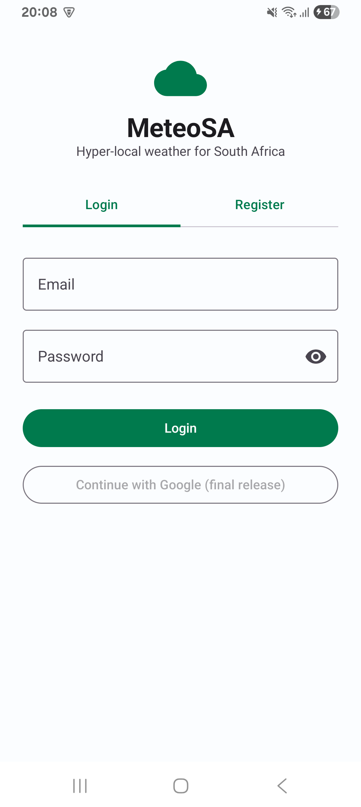 | 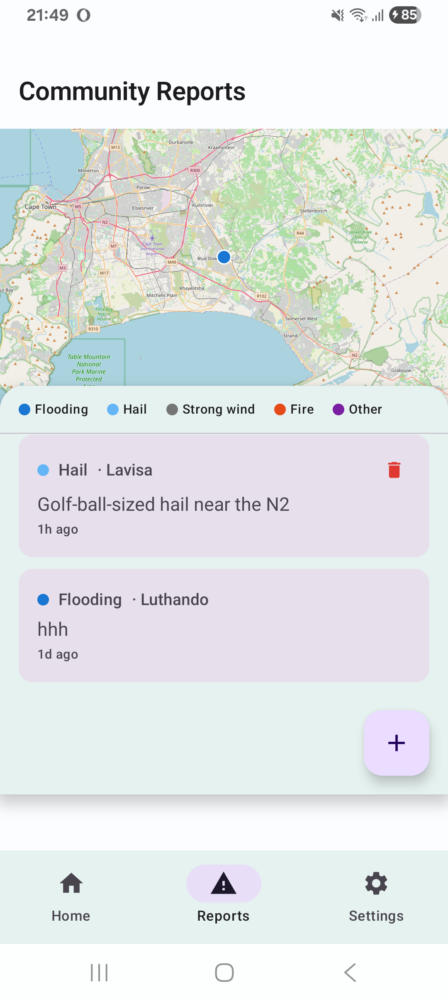 |

| Community Reports | Settings |
|---|---|
| 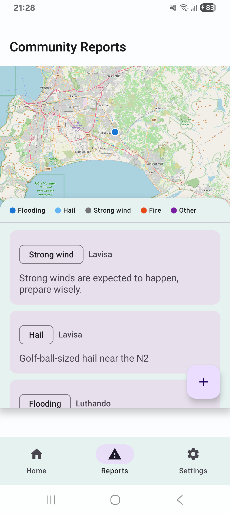 | 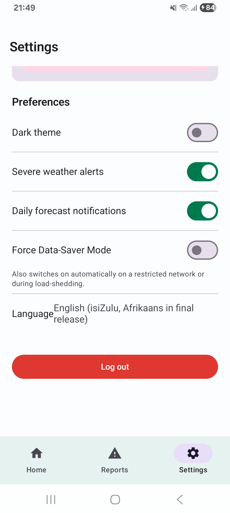 |

| SSO - sign-in screen | SSO - signed in |
|---|---|
| 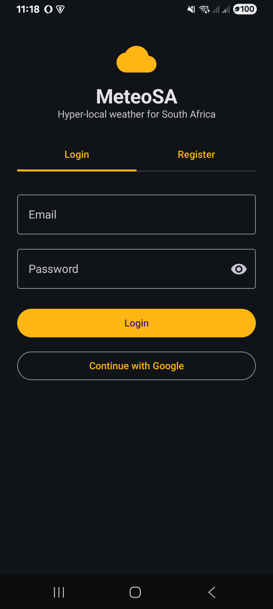 | 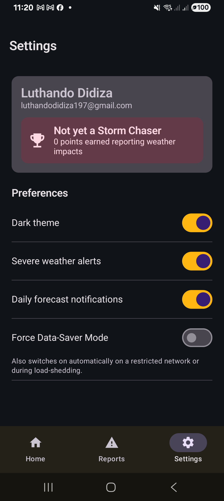 |

| Multi-language (isiZulu) | Multi-language (Afrikaans) |
|---|---|
| 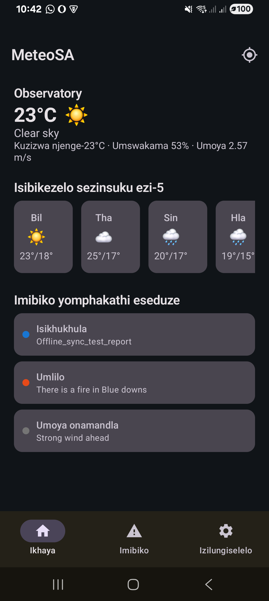 | 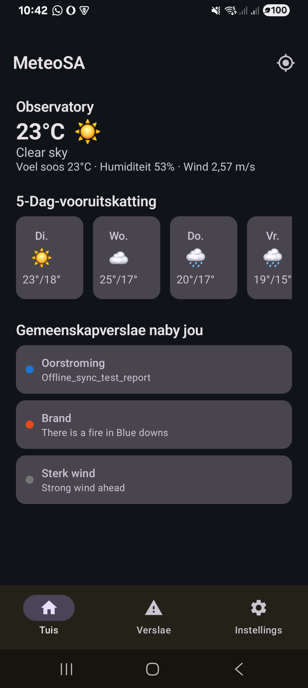 |

| Saved Locations | Profile Picture Upload |
|---|---|
| 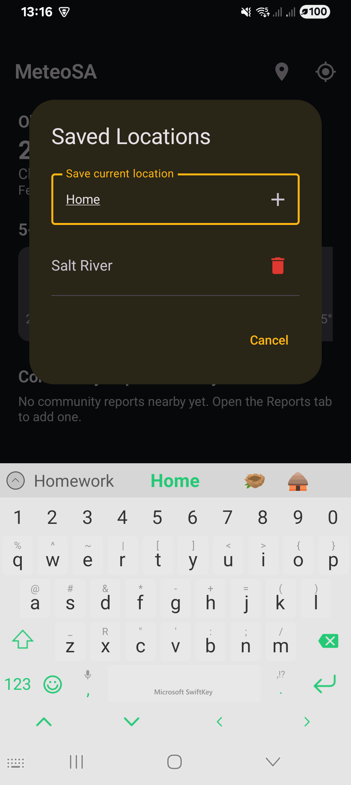 | 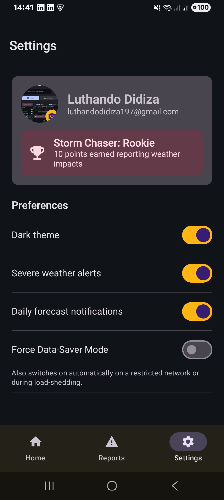 |

| Real-time push notification |
|---|
| 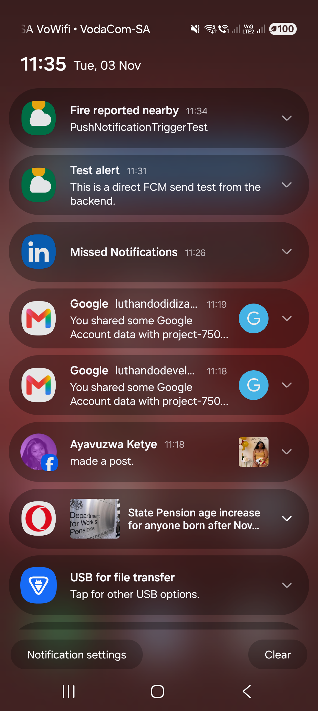 |

## Demo video

- [Part 2 demonstration video](https://drive.google.com/file/d/1hkOiiqpe1PlpYy0-1O2JXCWfs50HBMma/view?usp=sharing)
- Final PoE demonstration video: link to be added here once recorded.

## AI usage

See the separate AI-use write-up submitted alongside this PoE part.
